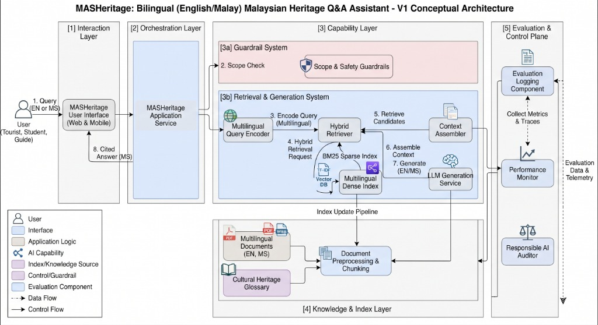

# Architecture Decisions & Traceability — MASHeritage

## Architecture Overview

---

## Step C2 — Architecture Needs from Requirements

| Requirement ID | What does the requirement need? | Architecture Response |
|---|---|---|
| FR2 / NFR2 / RAI1 | Cross-lingual retrieval and equal bilingual accuracy across English and Malay | Multilingual dense embedding model (BGE-M3) combined with sparse BM25 index |
| FR3 / RAI3 | Answers must include verifiable source references linked to official documents | Document metadata tracking, section chunking, and strict citation formatting in generation |
| FR4 / RAI2 | Out-of-scope queries must be appropriately refused and redirected | Scope and safety control guardrail pre-check layer |
| NFR1 | Responses must meet the defined latency threshold (< 4.0s p90) | Optimized hybrid retrieval index and streaming model API integration |

---

## Architecture Decision Record (ADR)

### ADR 1: Adoption of Hybrid Retrieval (Dense + Sparse) with Multilingual Embeddings
- **Requirement / Constraint**: FR2, NFR2, RAI1 (Bilingual support, cross-lingual matching, and minimizing performance gaps between languages).
- **Alternatives Considered**: 
  1. Pure keyword search (BM25) — fails on semantic cross-lingual queries (Malay query to English document).
  2. Pure dense vector search — prone to missing exact historical proper nouns and site codes.
- **Selected Option**: Hybrid retrieval combining BGE-M3 multilingual dense embeddings and BM25 sparse search.
- **Trade-off Accepted**: Higher architectural complexity and indexing overhead, but significantly better cross-lingual retrieval performance on specialized heritage terminology.

### ADR 2: Explicit Scope Guardrail & Abstention Layer
- **Requirement / Constraint**: FR4, RAI2 (Preventing out-of-scope queries and ensuring high refusal rates).
- **Alternatives Considered**: 
  1. Relying entirely on LLM system prompt instructions.
  2. Building an external custom intent-classification microservice.
- **Selected Option**: Lightweight rule-based and embedding-similarity pre-check combined with system prompt constraints that trigger automated fallback/refusal templates.
- **Trade-off Accepted**: Risk of occasional false-positive refusals on borderline heritage queries, but provides reliable safety control against hallucinations.

---

## Initial Requirements Traceability Matrix

| Objective | Requirement | Evaluation Criterion | Architecture Element | Later Evidence |
|---|---|---|---|---|
| [O1] | FR1, FR3 | Source Citation and Support | Document Knowledge Source, Hybrid Retriever, LLM Generation Service | Evaluation test set citation-match logs |
| [O2] | NFR2, RAI1 | Bilingual Retrieval & Answer Accuracy | BGE-M3 Multilingual Embeddings, BM25 Index, Cross-lingual pipeline | Per-language Recall@5 and correctness scores |
| [O3] | FR4, RAI2 | Out-of-Scope Refusal | Scope & Safety Control guardrail component | Abstention success rate on test refusal set |

---

### Reflection: Topic 2 Part C
*Which architecture decision involved the most important trade-off? Which requirement drove the decision, and what trade-off did you accept?*
> **Reflection Answer**: ADR 1 (Adopting hybrid retrieval over pure dense or sparse search) involved the most critical trade-off. Driven by requirement FR2 and RAI1 (cross-lingual retrieval parity), we accepted higher engineering complexity and indexing overhead in exchange for robust cross-lingual retrieval between Malay queries and English documentation.
