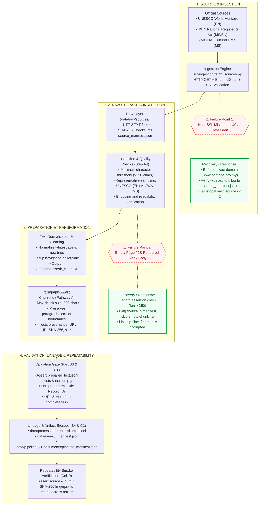

# Week 3 Pipeline Diagram

The following Mermaid diagram visualises the full V1 data‑engineering pipeline for the Topic 3 lab, including source ingestion, raw storage, inspection, preparation, validation, lineage, and repeatability smoke‑test.

*When viewed in Antigravity or any Mermaid‑compatible renderer, this diagram will appear as a richly‑styled flowchart.*